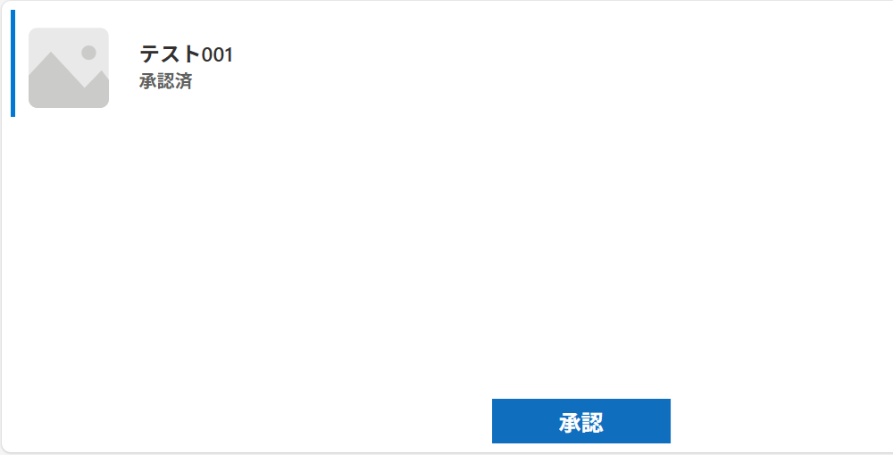
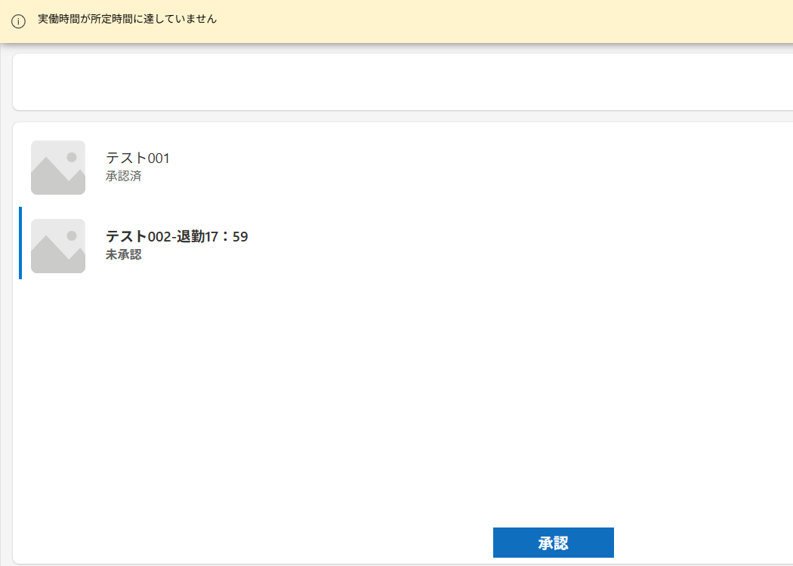
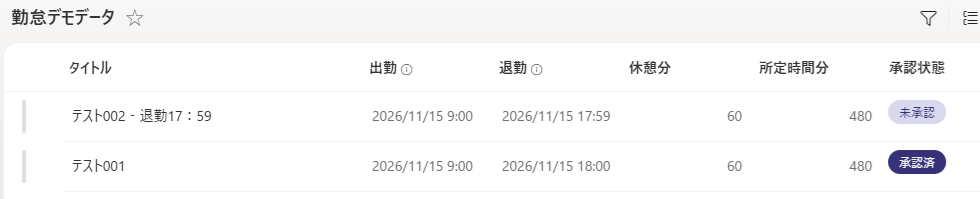

# Power Apps 勤怠承認デモ

出勤・退勤の時刻から休憩時間を引き、実働が所定時間と一致するかを承認前に確認するデモです。Power Appsの画面で「承認」を押すと判定し、一致した行の承認状態をMicrosoft Listsに保存します。

## 動作確認

所定時間は両方とも480分です。テストには架空の勤怠データを使いました。

### 1. 実働480分で承認

9:00〜18:00から休憩60分を引くと実働480分です。Power Appsで「承認」を押すと、テスト001が「承認済」になりました。

### 2. 実働479分で警告

退勤を17:59にしたテスト002は実働479分です。承認ボタンを押すと「実働時間が所定時間に達していません」と表示され、未承認のままでした。

### 3. Microsoft Listsで保存結果を確認

Listsには、480分のテスト001が「承認済」、479分のテスト002が「未承認」と表示されています。

## 作り方

1. Microsoft Listsにリストを作り、出勤・退勤を日時列、休憩分・所定時間分を数値列、承認状態を選択肢列で設定します。承認状態の初期値は「未承認」にします。
2. Power AppsのキャンバスアプリからSharePointコネクタでリストに接続します。ギャラリーにテスト名と承認状態を表示します。
3. 承認ボタンの処理で、退勤と出勤の差を分に換算し、休憩分を引いて所定時間分と比較します。一致した場合は対象の行を「承認済」に更新し、差がある場合は警告を表示します。
4. 上の2件で、アプリの表示とLists上の承認状態を確認します。

## 検証範囲

同日勤務の2ケースを確認しました。日をまたぐシフトや打刻漏れは今後の検証項目です。WinActorでの操作自動化は別途検証予定です。
